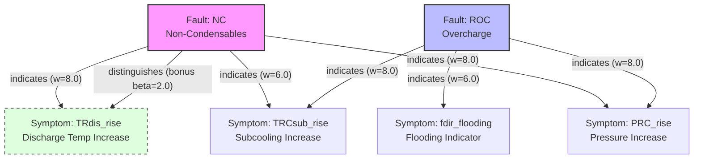

# Chiller Graph-Grounded Evidence Scoring (GGES) Walkthrough

This repository implements a **Physics-Informed Knowledge Graph** approach to chiller fault diagnosis. The engine, `ChillerGGESEngine`, transforms raw sensor deviations into thermodynamically grounded diagnostic verdicts.

---

## 1. Engine Architecture & Execution Flow

The diagnostic process follows a strict linear flow from raw data to a final verdict:

1.  **Input**: Receive a dictionary of sensor **z-scores** (standard deviations from the mean).
2.  **Symptom Activation Layer (SAL)**: Convert z-scores into directional confidence values (0.0 to 1.0) based on physical expectations (e.g., "Pressure should rise").
3.  **Graph Traversal**: For every possible fault in the graph, inspect its outgoing edges to activated symptoms.
4.  **Evidence Scoring**: Accumulate support weights, add discriminative bonuses, and subtract penalties for physical contradictions.
5.  **Verdict**: Identify the fault with the highest net score. If it exceeds **theta_min**, it is diagnosed; otherwise, it is "Unresolved".

---

## 2. Detailed Function Walkthrough

### `__init__(self, beta, gamma, theta_min, tau_weak, tau_strong)`
Initializes the thermodynamic hyperparameters used in the scoring math:
*   **`beta`**: The bonus multiplier for **distinguishing** symptoms.
*   **`gamma`**: The penalty for **contradictory** evidence (where sensors move opposite to physics).
*   **`theta_min`**: The "acceptance" threshold.
*   **`tau_weak` / `tau_strong`**: Defines the sensitivity range for sensor deviations.

### `_build_demo_graph(self)`
Constructs the knowledge graph using `networkx.MultiDiGraph`.
*   **Fault Nodes**: `NC` (Non-Condensables), `ROC` (Overcharge), `RCWF` (Reduced Flow).
*   **Symptom Nodes**: Defines the sensor name and the **expected direction** (+1 for rise, -1 for drop).
*   **Edges**:
    *   `relation="indicates"`: A standard symptom associated with a fault, assigned a weight (e.g., 8.0).
    *   `relation="distinguishes"`: A special edge that tells the engine to apply the **beta bonus** if this symptom is present.

### `symptom_activation(self, sensor_z_scores)`
The **Physics-Informed** bridge. For each symptom node in the graph:
1.  It calculates `a_s = expected_direction * z_score`.
2.  If `a_s` is positive, the sensor moved as predicted (Supportive).
3.  If `a_s` is negative, the sensor moved opposite to prediction (Contradictory).
4.  It applies a piecewise linear activation to map the magnitude to a `conf` (confidence) between 0.0 and 1.0.

### `diagnose(self, sensor_z_scores)`
The core reasoning engine. It calculates the **Graph-Grounded Evidence Score (GGES)** for each fault:

```text
GGES = (Supportive Weight * Conf) + (Distinguishing Bonus * Conf) - (Penalty * Weight * Conf)
```

1.  **Supportive**: Added when a fault's `indicates` symptom is confirmed by the sensor.
2.  **Bonus**: Added when a `distinguishes` edge is supportive (discriminates between similar faults).
3.  **Penalty**: Subtracted if an `indicates` symptom is **contradicted** (e.g., pressure drops when it should rise).

---

## 3. Usage Example

Here is how to use the engine in your own Python scripts:

```python
from chiller_gges import ChillerGGESEngine

# 1. Initialize the engine
engine = ChillerGGESEngine(beta=2.0, gamma=0.5)

# 2. Prepare sensor z-scores (deviations from normal operation)
# In this case, we simulate a Non-Condensable Gas (NC) fault
telemetry = {
    "PRC": 2.5,    # High Condenser Pressure
    "TRdis": 2.0,  # High Discharge Temperature
    "TRCsub": 1.5, # High Subcooling
    "FWC": 0.0     # Flow is normal
}

# 3. Run the diagnosis
result = engine.diagnose(telemetry)

# 4. Interpret results
print(f"Verdict: {result['verdict']}")
print(f"Confidence Score: {result['top_score']}")
print(f"Full Scoreboard: {result['all_scores']}")
```

---

## 4. Execution Trace: How a Diagnosis is Calculated

Let's trace what happens internally when you call `engine.diagnose(telemetry)` with the following data:

```python
telemetry = {
    "PRC": 2.0,    # High Condenser Pressure
    "TRdis": 2.2,  # High Discharge Temperature
    "TRCsub": 1.8  # High Subcooling
}
```

### Step 1: Symptom Activation Layer (SAL)
The engine looks at every symptom in the graph and compares it to the telemetry. 

**Note on Thresholds (`p997`):**
In this engine, we use statistical thresholds to determine "activation". If your sensor has a 99.7th percentile value (**p997** or 3-sigma), you can think of the activation as follows:
*   **Weak Threshold (`tau_weak`)**: Usually set to 0.3 (or 30% of your reference threshold). 
*   **Strong Threshold (`tau_strong`)**: Set to 1.5 or 2.0 (representing 150% to 200% of the statistical limit). 
*   **Example**: If the Observed z-score is 2.0 (meaning it is twice the typical deviation or ~6 sigma if p997=3), then **Confidence = 1.0**.

**Activation Calculations:**
*   **PRC_rise**: Physics expects a rise (+1). Observed z-score is 2.0. Result: Supportive. Since 2.0 > `tau_strong` (1.5), **Confidence = 1.0**.
*   **TRdis_rise**: Physics expects a rise (+1). Observed z-score is 2.2. Result: Supportive. **Confidence = 1.0**.
*   **TRCsub_rise**: Physics expects a rise (+1). Observed z-score is 1.8. Result: Supportive. **Confidence = 1.0**.
*   **fdir_flooding**: Physics expects a drop (-1). Observed z-score is 0.0. **Confidence = 0.0** (No activation).

### Step 2: Scoring the "NC" (Non-Condensable) Hypothesis
The engine traverses the edges starting from the **NC** node. 

**Wait, what is the direction?** 
In the graph, edges flow from **Fault → Symptom**. This represents physical causality: "If Non-Condensables (NC) are present, it **causes** a Pressure Rise (PRC_rise)." 
The reasoning engine calculates the score by looking at all symptoms a fault *should* produce and checking if the telemetry confirms them.

**NC Scoring Breakdown:**
1.  `NC -> PRC_rise` (Weight 8.0): Conf 1.0 is supportive. **+8.0 points**.
2.  `NC -> TRCsub_rise` (Weight 6.0): Conf 1.0 is supportive. **+6.0 points**.
3.  `NC -> TRdis_rise` (Weight 8.0): Conf 1.0 is supportive. **+8.0 points**.
4.  `NC -> TRdis_rise` (**Distinguishes Bonus**): Conf 1.0 is supportive. Apply `beta` (2.0). **+2.0 points**.
*   **NC Total Score: 24.0**

### Step 3: Scoring the "ROC" (Overcharge) Hypothesis
1.  `ROC -> PRC_rise` (Weight 8.0): Conf 1.0 is supportive. **+8.0 points**.
2.  `ROC -> TRCsub_rise` (Weight 8.0): Conf 1.0 is supportive. **+8.0 points**.
3.  `ROC -> fdir_flooding` (Weight 6.0): Conf is 0.0. **+0 points**.
*   **ROC Total Score: 16.0**

### Step 4: Final Verdict
*   **NC (24.0)** vs **ROC (16.0)**.
*   The winner is **NC**. 
*   Since 24.0 is much higher than the minimum threshold (`theta_min = 0.5`), the verdict is confirmed as **"NC"**.

## 6. Graph Representation (NC vs ROC)

The following diagram illustrates the relationship between the two primary fault hypotheses and their symptoms, including the **Expert Weights** (\( w_0 \)) and the **Distinguishing Bonus** (\( \beta \)).

### Visual Knowledge Graph



### Thermodynamic Hyperparameters & Activation logic

The engine uses statistical thresholds to determine how much "trust" to place in a sensor reading.

| Parameter | Value | Definition | Physical Meaning (p997 = 3.0) |
| :--- | :--- | :--- | :--- |
| **`tau_weak`** | `0.3` | Noise Floor | Z-scores below **0.9** (0.3 * 3) are ignored as random noise. |
| **`tau_strong`** | `1.5` | Saturation | Z-scores above **4.5** (1.5 * 3) are treated as 100% certain physical evidence. |
| **`beta`** | `2.0` | Discrim. Bonus | Added to the score if a symptom uniquely identifies the fault (e.g., `TRdis` for `NC`). |
| **`gamma`** | `0.5` | Penalty | Subtracted if a sensor moves opposite to expectation (e.g., Pressure drops when it should rise). |

### Scoring Summary Table

| Fault | Symptom | Relation | Weight (\( w_0 \)) | Activation Condition |
| :--- | :--- | :--- | :--- | :--- |
| **NC** | PRC_rise | `indicates` | 8.0 | Sensor PRC rises |
| **NC** | TRCsub_rise | `indicates` | 6.0 | Sensor TRCsub rises |
| **NC** | TRdis_rise | `indicates` | 8.0 | Sensor TRdis rises |
| **NC** | TRdis_rise | `distinguishes` | **+2.0** | (Unique to NC) |
| **ROC** | PRC_rise | `indicates` | 8.0 | Sensor PRC rises |
| **ROC** | TRCsub_rise | `indicates` | 8.0 | Sensor TRCsub rises |
| **ROC** | fdir_flooding| `indicates` | 6.0 | Sensor fdir drops (-1) |

## 8. Database Schema & Mapping (HT-CH-01)

The knowledge graph is persisted in a relational database to enable scalability and traceability. The following tables define the structure for **HT-CH-01** (Asset ID: `C_100`) based on the `sgp7_dev` environment.

### Core Tables

1.  **`gges_fault_nodes`**: Stores the 6 primary fault hypotheses (`CF`, `RL`, `ROC`, `RCWF`, `REWF`, `NC`).
2.  **`gges_symptom_nodes`**: Stores the 14 thermodynamic symptoms, mapping them to physical `sensor_id` values or SQL-based formulas.
3.  **`gges_edges`**: Defines the many-to-many relationship (`indicates` or `distinguishes`) and expert weights.

### HT-CH-01 Sensor Mapping

| Physics Symbol | Sensor ID | Sensor Name | Diagnostic Role |
| :--- | :--- | :--- | :--- |
| `PRC` | `C_100_2410` | `CH-CON-RFT-PRES` | Condenser Refrigerant Pressure |
| `PRE` | `C_100_2405` | `CH-EVA-RFT-PRES` | Evaporator Refrigerant Pressure |
| `TRdis` | `C_100_2408` | `CH-CON-RFT-TEMP` | Discharge Temperature (Proxy) |
| `Tsuc` | `C_100_2403` | `CH-EVA-RFT-TEMP` | Suction Temperature |
| `kW` | `C_100_2919_MD`| `CH-KW-COMBINED` | Compressor Power |
| `FWC` | `C_100_2029` | `CH-CWS-FLOW` | Condenser Water Flow |
| `FWE` | `C_100_2028` | `CH-CHWR-FLOW` | Chilled Water Flow |

### Derived Logic Examples

*   **Subcooling Rise (`TRCsub_rise`)**: Calculated using the difference between refrigerant temperature and leaving water temperature: `z_score(CH-CON-RFT-TEMP - CH-CON-L-TEMP) > tau_weak`.
*   **Flooding Indicator (`fdir_flood`)**: A composite physics indicator: `z_score(Tsuc - (TRdis^2 + TRCsub^2)) < 0`.

---

## 9. Demo Scenarios in the Code

The `if __name__ == "__main__":` block at the end of `chiller_gges.py` demonstrates three critical behaviors:

1.  **NC Scenario**: Shows how the **distinguishes** bonus on Discharge Temp allows `NC` to outscore `ROC` even though they share pressure symptoms.
2.  **ROC Scenario**: Shows how the flooding indicator (`fdir`) specifically triggers a high score for Refrigerant Overcharge.
3.  **Contradiction Scenario**: Shows how a single sensor moving in the wrong direction (Pressure dropping when it should rise) creates a negative penalty that suppresses the fault score.
