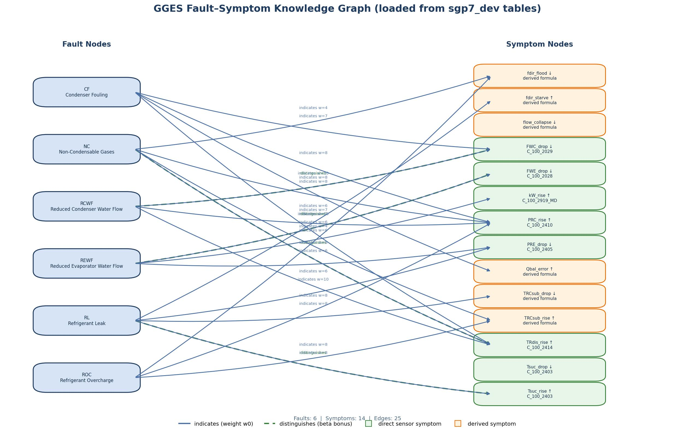

# GGES Fault–Symptom Graph Framework
## Chiller Root-Cause Diagnosis Slides (HT-CH-01)

---

## Slide 1 — GGES Scoring and ASHRAE Background

**Graph-Grounded Evidence Scoring (GGES)** converts continuous chiller telemetry into a physics-consistent fault verdict.

**Problem it solves**
- Chillers (vapour-compression cycle) couple evaporator, compressor, condenser, and water loops.
- Different faults share overlapping sensor signatures (e.g. NC vs ROC both raise condenser pressure).
- Closed-set ML can force an unseen fault into the nearest known class.

**ASHRAE foundation**
- Built on **ASHRAE RP-1043** chiller FDD benchmark and thermodynamic first principles.
- Research frame (SSRN-7656122 / PCLC-PGM): sensor deviations → directional symptoms → graph scoring → root cause.
- Two-layer diagnostic core used here:
  1. **Fault nodes** (hypotheses)
  2. **Symptom nodes** (directional physical evidence)

**Scoring idea (one line)**

```text
GGES(fault) = Support (indicates) + Bonus (distinguishes) - Penalty (contradiction)
```

**Our asset focus:** HT-CH-01 (`C_100`) in `sgp7_dev`, using 1-min telemetry aggregates.

---

## Slide 2 — Fault Nodes, Symptom Nodes, and Edge Types

**Many-to-many, two-layer graph**

```text
Fault  --(indicates / distinguishes)-->  Symptom
```

| Layer | Count (paper) | Examples |
| --- | --- | --- |
| Fault nodes | 6 | CF, RL, ROC, RCWF, REWF, NC |
| Symptom nodes | 14 | PRC_rise, FWC_drop, fdir_flood, Qbal_error |

**Edge types used for GGES scoring**

| Relation | Meaning | Role in score |
| --- | --- | --- |
| `indicates` | Fault is expected to produce this symptom | Adds `weight × confidence` |
| `distinguishes` | Symptom uniquely separates one fault from competitors | Adds `beta × confidence` bonus |

**Why both edges matter**
- Shared symptoms alone cannot separate NC vs ROC.
- A `distinguishes` edge (e.g. NC → TRdis_rise) breaks the tie when discharge temperature rises.

**DB tables in `sgp7_dev`**
- `gges_fault_nodes`
- `gges_symptom_nodes`
- `gges_edges`

---

## Slide 3 — Symptoms: Direct Sensors, Derived Formulas, and Z-Score Activation

### Symptom sources

| Type | Examples | How measured |
| --- | --- | --- |
| Direct sensor | PRC_rise, FWC_drop, PRE_drop, kW_rise | One mapped `sensor_id` from `sensor_master` |
| Derived physics | TRCsub_rise, fdir_flood, Qbal_error, flow_collapse | Formula over multiple sensors / features |

**HT-CH-01 direct mapping examples**
- PRC → `C_100_2410` (`CH-CON-RFT-PRES`)
- FWC → `C_100_2029` (`CH-CWS-FLOW`)
- TRdis proxy → `C_100_2414` (`CH-OIL-DIS-TEMP`)

### What is a z-score? (basis of symptom activation)

```text
z = (current_value - normal_mean) / normal_std
```

- `z = 0` → normal
- large positive / negative → strong abnormal deviation
- Symptom activation uses direction × z:

```text
a_s = expected_direction × z
conf = 0 if |a_s| < tau_weak
conf = 1 if |a_s| >= tau_strong
conf = linear scale otherwise
```

| Parameter | Typical value | Meaning |
| --- | --- | --- |
| `tau_weak` | 0.3 | Noise floor (ignore small deviations) |
| `tau_strong` | 1.5 | Strong certainty (full confidence) |

**Key point:** We do not train a model for `TRCsub_rise`. We compute/derive the feature, convert to z-score, then activate the symptom node by direction.

---

## Slide 4 — How ASHRAE / Paper Weights Are Arrived At

Weights (`w0`) on `indicates` edges are **expert physics priors**, not data-learned correlations.

**Three-step protocol from the paper**
1. Start from ASHRAE RP-1043 thermodynamic primacy of each fault–symptom link.
2. SME ranking of primary vs secondary vs weak indicators.
3. Keep weights fixed so zero-shot diagnosis of unseen faults remains valid.

**Weight tiers**

| Tier | Weight range | Meaning |
| --- | --- | --- |
| Primary | 7–10 | Must-happen signature (smoking gun) |
| Secondary | 3–6 | Common downstream / partially masked effects |
| Weak | 1–2 | Noisy / incidental support |

**Important separation**
- `indicates` carries `w0` (support strength).
- `distinguishes` does not use a per-edge learned weight; it triggers a global bonus `beta` (paper default 2.0).
- Contradiction uses penalty `gamma` (paper default 0.5) when the sensor moves opposite to physics.

**Why not learn weights from data?**
Learning would bias toward faults already seen. Expert ASHRAE weights preserve first-principles diagnosis for first-occurrence / unseen faults.

---

## Slide 5 — Graph Built from Tables (Reference Image)

The image below is **generated from the live DB tables** (not hand-drawn). All 6 faults and **14 symptom nodes** are loaded from `sgp7_dev`.



**How to regenerate the artifact**

```bash
# from graph_experiment/
set PGPASSWORD=<dev_password>
python render_gges_graph.py --out gges_fault_symptom_graph.jpg
```

`render_gges_graph.py` reads:
1. `sgp7_dev.gges_fault_nodes`
2. `sgp7_dev.gges_symptom_nodes` (direct = has `sensor_id`, derived = formula)
3. `sgp7_dev.gges_edges` (`indicates` / `distinguishes` + weight)

**Table → graph mapping**

| Table | Graph role |
| --- | --- |
| `sgp7_dev.gges_fault_nodes` | Left-side fault hypotheses |
| `sgp7_dev.gges_symptom_nodes` | Right-side directional symptoms (14) |
| `sgp7_dev.gges_edges` | Directed edges with `indicates` / `distinguishes` + weight |

**Current seed counts (HT-CH-01)**
- 6 faults
- 14 symptoms (8 direct sensors + 6 derived)
- 25 edges

---

## Slide 6 — Traversal Example: Root Cause with Distinguishes + Weights

**Telemetry (z-scores)**
- PRC = +2.0
- TRCsub = +1.8
- TRdis = +2.2
- fdir ≈ 0 (no flooding activation)

**Step A — Symptom activation**
- PRC_rise → supportive, conf = 1.0
- TRCsub_rise → supportive, conf = 1.0
- TRdis_rise → supportive, conf = 1.0
- fdir_flood → conf = 0.0

**Step B — Score ROC (shared symptoms only)**
- indicates PRC_rise: 8.0 × 1.0 = 8.0
- indicates TRCsub_rise: 8.0 × 1.0 = 8.0
- indicates fdir_flood: 0
- **ROC total = 16.0**

**Step C — Score NC (shared + distinguishing)**
- indicates PRC_rise: 8.0 × 1.0 = 8.0
- indicates TRCsub_rise: 6.0 × 1.0 = 6.0
- indicates TRdis_rise: 8.0 × 1.0 = 8.0
- distinguishes TRdis_rise: beta × 1.0 = +2.0
- **NC total = 24.0**

**Verdict**
- NC (24.0) > ROC (16.0)
- Root cause selected: **Non-Condensable Gases (NC)**
- The `distinguishes` edge on discharge-temperature rise is what separates NC from ROC when pressure/subcooling look similar.

```text
Activated symptoms → traverse Fault→Symptom edges → accumulate w0 and beta → argmax GGES
```
